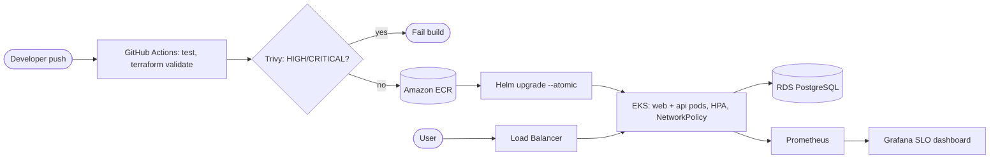

# Architecture

- **Network:** VPC 10.20.0.0/16, private subnets for nodes, isolated database subnets, one NAT gateway (dev cost trade-off).
- **Security:** GitHub OIDC role (no stored AWS keys), RDS password in Secrets Manager, database security group only accepts EKS nodes, non-root containers with read-only file systems, default-deny NetworkPolicy, immutable ECR tags with scan-on-push.
- **Estimated cost if deployed (dev):** about $100/month: EKS control plane ~$73, 2x t3.small, db.t3.micro, NAT. Run `terraform destroy` when not demoing.
